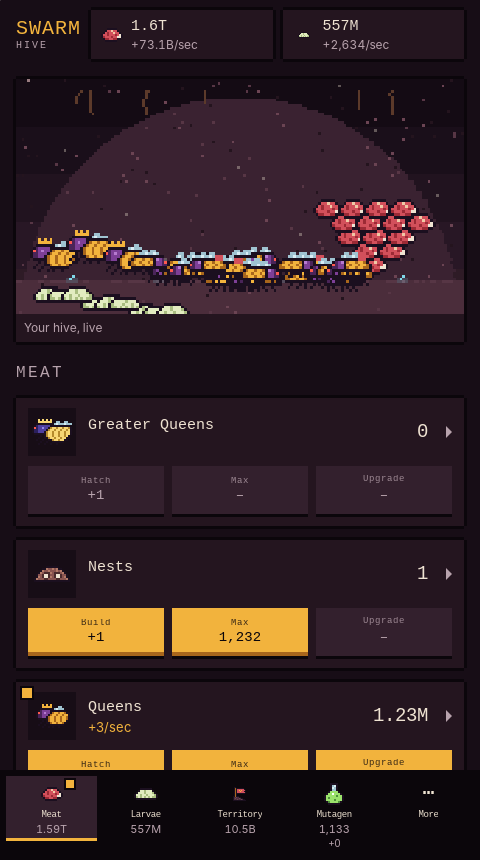
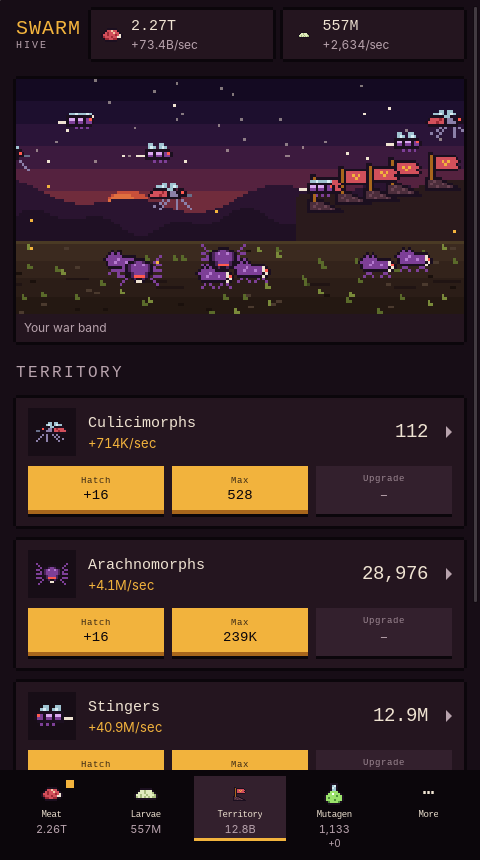
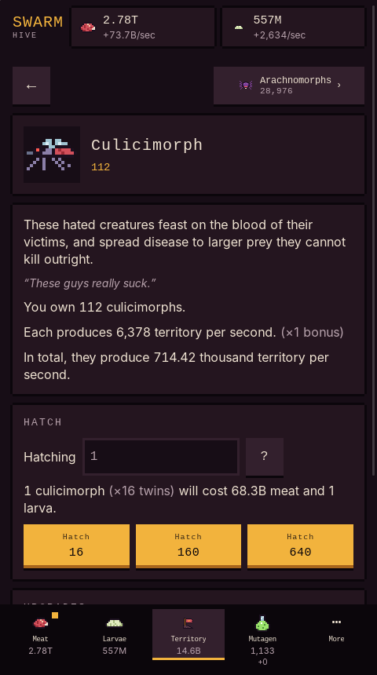
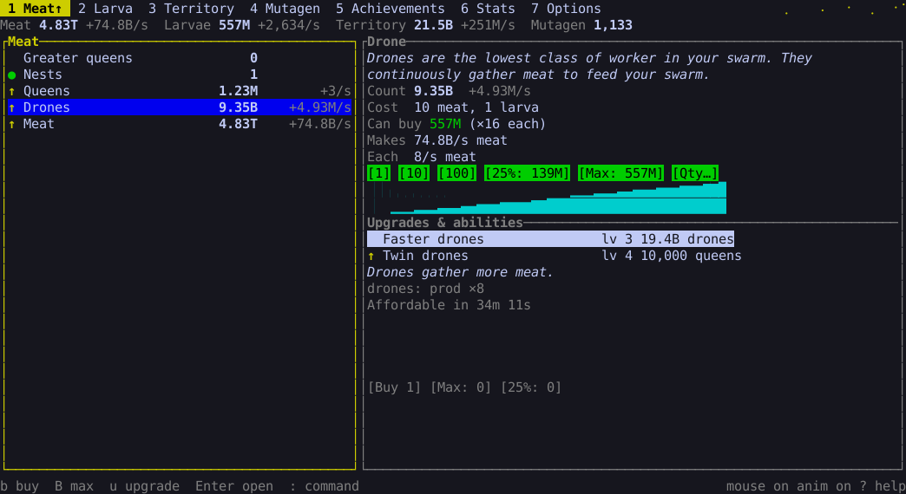
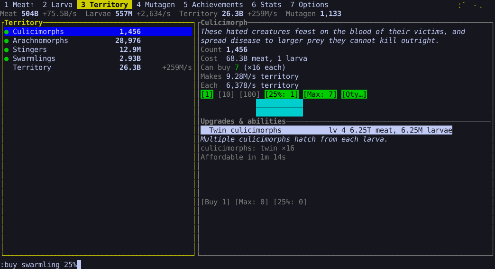
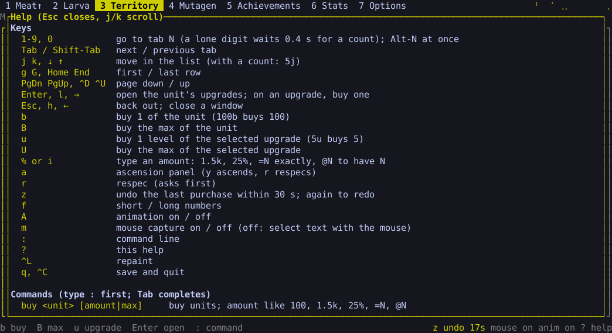

The first native release of Swarm Simulator for Linux, built on a Rust port of the game engine.

## Downloads

| File | What it is |
|---|---|
| `Swarm Simulator_0.1.0_amd64.AppImage` | The desktop app. Runs on any distribution; it bundles WebKitGTK, hence the size. `chmod +x` it and run it. |
| `Swarm Simulator_0.1.0_amd64.deb` | The same desktop app for Debian and Ubuntu, using the system WebKitGTK (`libwebkit2gtk-4.1-0`). |
| `swarm-tui-linux-x86_64` | The terminal game. A single binary that needs only glibc. |
| `swarm-linux-x86_64` | The command-line client: play, export, import, and convert saves. |

The terminal game and the command-line client share one save, in `~/.local/share/swarm/save.txt`. The desktop app keeps its save in `~/.local/share/com.swarmsim.desktop/save.txt`. All three read old browser saves through import, and `swarm convert` turns a save from one format into the other.

## Desktop

## Terminal

Keyboard-first, with the mouse as an equal path. `?` shows every key and command, `:` opens a command line, `m` releases the mouse for text selection, and `A` turns the animation off.

## Under the hood

One Rust engine drives all three, and the web game runs the same engine as WebAssembly. It matches the original game on its recorded scenarios; the only differences come from rounding beyond the 15th significant digit. See [rust/README.md](https://github.com/druzn3k/swarm/blob/v0.1.0/rust/README.md) to build from source.
